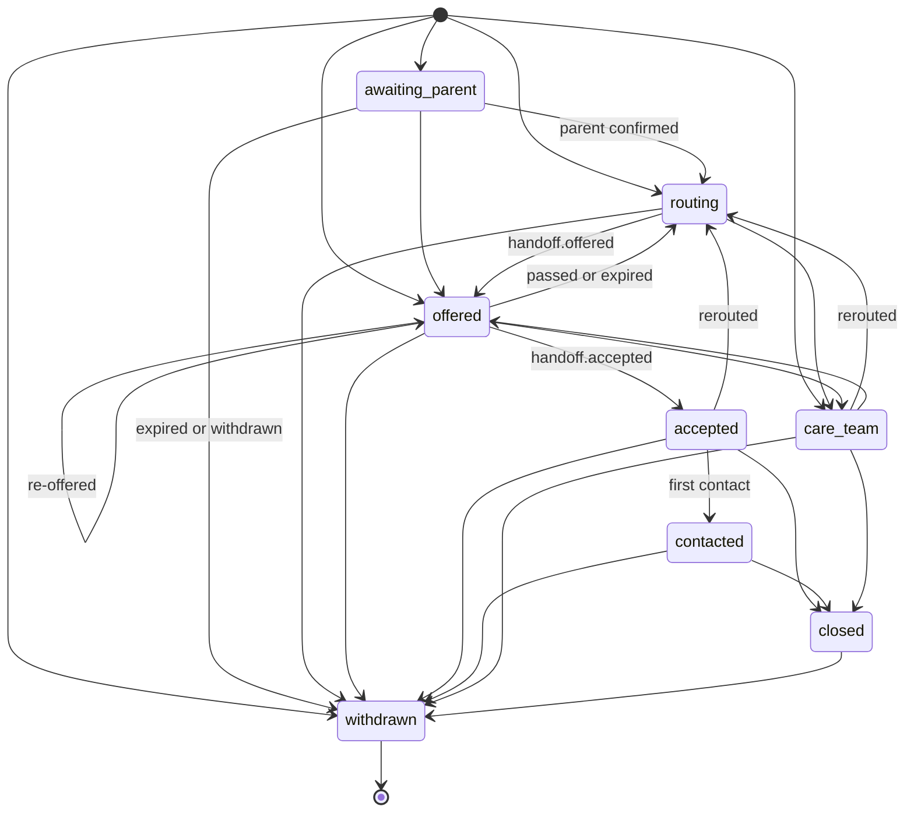

# A formal specification of the Always Pathway handoff format, version 0.2

**Status:** independent research draft, revision 1 (2026-11-26).
**Normative base:** Always Pathway standard v0.2, JSON Schema
[`upstream/always-pathway-v0.2.schema.json`](upstream/always-pathway-v0.2.schema.json),
© Always Foundation, CC BY 4.0.
**This document:** © 2026 Daniel Dizon, CC BY 4.0. It restates, makes precise
and extends the upstream standard. It is not published by Always Foundation and
does not replace the upstream text; where the two disagree, the upstream
standard governs conformance to "Always Pathway v0.2", and this document
governs conformance to the profiles defined in §9.

Changes from the upstream material are indicated in §1.3.

---

## 1. Introduction

### 1.1 Purpose

The Always Pathway standard describes how one organisation passes a consenting
person to another (for example from an event team to a local church) so that
someone can welcome them, whatever software each side uses. Version 0.2
defines four JSON object types in one JSON Schema: an organisation directory
entry, a response (the person and their consent), a consent record, and a
status event. It does not define how those objects relate over time.

This document supplies what an implementer needs beyond the schema:

1. precise semantics for every field, in RFC 2119 terms (§3 to §6);
2. the invariants that the schema cannot express, each with a stable
   identifier that a validator reports (§7);
3. a state machine for the life of one handoff, inferred from the state and
   event vocabularies of v0.2 (§8);
4. conformance classes and profiles (§9);
5. security and privacy analysis (§10, §11).

### 1.2 Conventions

The key words MUST, MUST NOT, REQUIRED, SHALL, SHALL NOT, SHOULD, SHOULD NOT,
RECOMMENDED, MAY and OPTIONAL are to be interpreted as described in BCP 14
(RFC 2119, RFC 8174) when, and only when, they appear in capitals.

JSON values are written in `monospace`. A JSON Pointer (RFC 6901) such as
`/consent/ageBand` identifies a location within an object. "Absent" means the
member is not present; `null` is never a valid value in this format.

Invariants are labelled `PWnnn`. The same labels are the issue codes of the
reference validator in this repository (`src/codes.ts`), and the conformance
vectors in `conformance/` are indexed by them.

### 1.3 Relationship to the upstream standard

This document:

- **restates** the upstream schema without changing any type, enumeration or
  constraint (§3 to §6);
- **adds** invariants PW101 to PW306 that follow from the upstream field
  descriptions, the upstream website's stated promises ("a parent agrees for
  anyone under 15", "updates carry no personal details at all"), and the
  documented behaviour of Always Foundation's reference implementation;
- **adds** a state machine (§8) and stream invariants PW401 to PW404, which
  v0.2 does not define;
- **defines** a closed-world strict profile (§9.2), expressed both as code and
  as a JSON Schema ([`../schema/pathway-v0.2-strict.schema.json`](../schema/pathway-v0.2-strict.schema.json));
- **records** gaps found while formalising v0.2 in
  [`../docs/findings.md`](../docs/findings.md).

Every added invariant notes its source. Where the source is an implementation
detail rather than the standard, the invariant is a SHOULD or is confined to
the strict profile.

---

## 2. Terminology and model

**Person.** The individual being handed on. Never identified across handoffs
by this format.

**Sender.** The organisation that holds the person's response and consent and
passes them on.

**Receiver.** The organisation offered the person. A receiver is identified by
its `Organisation.id`.

**Handoff.** One attempt to connect one person, by one sender, to a receiver,
under one consent record. A handoff has an identifier, `handoffId` (UUID),
that is meaningful only to the systems exchanging it.

**Message.** One of four object types: `Organisation`, `Response`, `Consent`
(always nested in a `Response`), and `HandoffEvent`.

**Personal data.** In this document, the members `/firstName` and `/contact`
of a `Response` and any value that identifies or contacts a person. The
upstream schema marks the first two "Restricted".

The model separates **content** from **status**:

```
            Response (personal data, consent)
 Sender ───────────────────────────────────────────▶ Receiver       once per handoff
        ◀───────────────────────────────────────────
            HandoffEvent (status only, no personal data)            many per handoff
```

A `Response` crosses a boundary at most once per handoff. Everything after
that is a `HandoffEvent`, which carries identifiers and states only.

---

## 3. Organisation

A directory entry for an organisation that can welcome people. Required:
`id`, `kind`, `displayName`, `trustLevel`, `country`.

| Member | Type | Semantics |
|---|---|---|
| `id` | UUID | Stable identifier of the organisation. MUST NOT be reused for a different organisation. |
| `kind` | `church` \| `ministry` \| `network` | |
| `displayName` | string ≤ 160 | Public name. |
| `trustLevel` | `listed` \| `claimed` \| `verified` \| `verified_youth` | Ordered: `listed` < `claimed` < `verified` < `verified_youth`. `verified_youth` asserts the organisation has been verified for work with minors. |
| `country` | ISO 3166-1 alpha-2 | |
| `region`, `suburb`, `postalCode` | strings | Locality, never a street address. |
| `location` | `{lat, lng}` | WGS 84 degrees. SHOULD be the locality centroid, not the building. |
| `languages` | BCP 47 tags | Languages in which the organisation can welcome people. |
| `offers` | `StepCategory[]` | Next steps the organisation provides. |
| `denomination`, `category`, `website`, `lastConfirmedAt`, `source` | | Descriptive. `source` records where public information came from. |

`StepCategory` is one of `church`, `explore`, `talk`, `youth`, `group`, `help`,
`read`.

---

## 4. Response

What a person shared, and their consent to share it. Required: `ageBand`,
`step`, `consent`.

| Member | Type | Semantics |
|---|---|---|
| `ageBand` | `under13` \| `13-14` \| `15-17` \| `18+` | The person's age band. Age is never sent as a date of birth. If there is reason to believe a stated band is wrong, the lower band applies (upstream reference implementation, rule CY-3). |
| `step` | `StepCategory` | The next step the person asked for. |
| `firstName` | string ≤ 60 | Restricted. MUST be absent when `ageBand` is `under13` (upstream schema). |
| `contact` | `{mobile?, email?}` | Restricted. "One method" (upstream description): see PW106. For `under13`, contact details are a parent's or guardian's. |
| `contact/mobile` | E.164 | `+` followed by 7 to 15 digits, first digit non-zero. |
| `contact/email` | RFC 5321 address | |
| `suburb`, `region`, `postalCode`, `country` | | Approximate location for routing. |
| `language` | BCP 47 | The person's preferred language. |
| `campaignId`, `placementId` | UUID | The sender's own attribution identifiers. Opaque to the receiver. |
| `consent` | `Consent` | REQUIRED. See §5. |

---

## 5. Consent

A record of what the person (or their parent) agreed to. The structure follows
the consent-receipt model of ISO/IEC TS 27560. Required: `id`, `purposes`,
`recipients`, `wordingVersion`, `party`, `ageBand`, `collectedAt`.

| Member | Type | Semantics |
|---|---|---|
| `id` | UUID | Identifies this consent record. |
| `purposes` | non-empty array of purpose codes | The uses agreed to. A set: order is not significant and items SHOULD NOT repeat (PW107). |
| `recipients` | array of `Organisation.id` | Organisations the person agreed may receive them. A set (PW107). |
| `allowNextNearby` | boolean, default `false` | If `true`, the person agreed that, should a named recipient be unable to welcome them, they may be offered to another suitable organisation nearby. |
| `wordingVersion` | string | Version of the consent wording shown. A receiver MAY refuse wording versions it does not recognise. |
| `party` | `self` \| `parent` | Who gave consent. |
| `ageBand` | `AgeBand` | Age band at the time of consent. MUST equal the enclosing response's `ageBand` (PW101). |
| `collectedAt` | RFC 3339 date-time | When consent was given. |
| `parentConfirmedAt` | date-time | When a parent or guardian confirmed, where `party` is `self` but parental confirmation was required. |
| `withdrawnAt` | date-time | When consent was withdrawn. Presence means the consent no longer permits any new processing. |

Purpose codes:

| Code | Meaning |
|---|---|
| `connect.church` | Pass the person to a receiving church or ministry so someone can welcome them. REQUIRED for any handoff (PW105). |
| `notify.sender` | The receiver may tell the sender how the handoff went, by status events. |
| `resources` | The person may be sent resources. |
| `stats.anonymous` | The response may be counted in de-identified totals. |

### 5.1 Age rules

The upstream website states: "Age comes before anything else. Under 13s are
never named, and a parent agrees for anyone under 15." Formally:

- **under13:** `firstName` absent; contact is a parent's; consent MUST be by
  or confirmed by a parent (PW102).
- **13-14:** consent MUST be by or confirmed by a parent (PW102).
- **15-17, 18+:** the person MAY consent for themselves.

"By or confirmed by a parent" means `party` is `parent`, or
`parentConfirmedAt` is present.

### 5.2 Withdrawal

Withdrawal is immediate for new uses. A response whose consent carries
`withdrawnAt` MUST NOT be sent (PW103). A system that learns of a withdrawal
for a handoff in flight MUST emit `consent.withdrawn` for that handoff, and
every receiver MUST stop processing and SHOULD delete the response, then MAY
emit `person.deleted`.

---

## 6. HandoffEvent

A CloudEvents 1.0 envelope carrying a status update. Required: `specversion`
(`"1.0"`), `type`, `source`, `id`, `time`, `data`. `data` admits only the
members below (`additionalProperties: false` upstream).

| `data` member | Type | Semantics |
|---|---|---|
| `handoffId` | UUID | The handoff this event concerns. REQUIRED for `handoff.*` and `consent.withdrawn` and `person.deleted` events (PW302). |
| `orgId` | UUID | The organisation acting or concerned. REQUIRED for `organisation.*` events (PW306). |
| `state` | `HandoffState` | The handoff's state after this event (§8). |
| `status` | `Status` | A pastoral outcome reported by the receiver. Only with `handoff.status_changed` (PW305). |
| `passReason` | `capacity` \| `language` \| `fit` \| `safeguarding` \| `other` | Only with `handoff.passed`, where it is REQUIRED (PW304). |

`Status` is one of `contacted`, `met_up`, `came_on_sunday`, `joined_group`,
`not_ready`, `asked_to_stop`.

Per CloudEvents, the pair (`source`, `id`) identifies an event. A receiver
MUST treat a second event with the same pair as a redelivery and process it at
most once; two events with the same pair and different content are an error
(PW403). Delivery order is not guaranteed; receivers MUST order a handoff's
events by `time` (PW404).

### 6.1 Event types

| `type` | Concerns | `data/state` after | Notes |
|---|---|---|---|
| `handoff.offered` | handoff | `offered` | A receiver has been offered the person. |
| `handoff.accepted` | handoff | `accepted` | The receiver accepted. |
| `handoff.passed` | handoff | `routing` | The receiver declined; `passReason` REQUIRED. |
| `handoff.expired` | handoff | `routing` or `withdrawn` | An offer timed out (`routing`), or parental confirmation timed out (`withdrawn`). |
| `handoff.rerouted` | handoff | `routing` | The handoff is being routed again (e.g. first contact overdue, or released by a care team). |
| `handoff.status_changed` | handoff | `accepted`, `contacted`, `care_team` or `closed` | Carries `status`. |
| `consent.withdrawn` | handoff | `withdrawn` | |
| `person.deleted` | handoff | absent or `withdrawn` | The receiver deleted the person's data. Terminal for that receiver. |
| `organisation.verified` | organisation | absent | |
| `organisation.suspended` | organisation | absent | |

`data/state` MAY be omitted on handoff events; when present it MUST be one of
the values in the table (PW303).

**Personal data.** No member of a `HandoffEvent`, including CloudEvents
extension attributes and `source`, MUST contain personal data (PW301).

---

## 7. Invariants

Each invariant has a code, a severity when violated (`error` or `warning`),
and a source. Codes in the PW0xx range are structural; PW1xx concern a
response and its consent; PW2xx a response together with its receiver; PW3xx
a single event; PW4xx a stream of events.

| Code | Severity | Rule | Source |
|---|---|---|---|
| PW001 | error | The object conforms to the upstream v0.2 schema for its type. | Upstream schema |
| PW002 | error (strict profile) | No members other than those defined for the type. | This document, §9.2 |
| PW101 | error | `/consent/ageBand` equals `/ageBand`. | Upstream model; a mismatch makes PW102 undecidable |
| PW102 | error | If `/ageBand` is `under13` or `13-14`, then `/consent/party` is `parent` or `/consent/parentConfirmedAt` is present. | Upstream website; reference implementation `minors.ts` |
| PW103 | error | `/consent/withdrawnAt` is absent in a response being sent. | Upstream website ("if she changes her mind, every system has to act on it") |
| PW104 | error | `parentConfirmedAt` and `withdrawnAt`, where present, are not earlier than `collectedAt`. | Temporal coherence |
| PW105 | error | `/consent/purposes` contains `connect.church`. | Upstream purpose semantics |
| PW106 | error | `/contact`, where present, has exactly one member. | Upstream description "One method" |
| PW107 | error | `purposes` and `recipients` contain no duplicates. | Set semantics |
| PW108 | error (with a clock) | `collectedAt` is not in the future. | Temporal coherence |
| PW109 | error (with a policy) | `collectedAt` is within the receiver's maximum consent age. | Reference implementation: 12 months |
| PW201 | error | The receiver's `id` is in `/consent/recipients`, or `/consent/allowNextNearby` is `true`. | Upstream consent semantics |
| PW202 | warning | The receiver's `offers`, where present, include the response's `step`. | Routing quality |
| PW203 | warning | If the person is under 18, the receiver's `trustLevel` is `verified_youth`. | Reference implementation (`youthPartnersOnly`) |
| PW301 | error | No string anywhere in the event matches an email address or an E.164 number. | Upstream schema description ("never personal details") |
| PW302 | error | `handoff.*`, `consent.withdrawn` and `person.deleted` events carry `data/handoffId`. | Event semantics |
| PW303 | error | `data/state`, where present, is permitted for the event type (§6.1). | §6.1 |
| PW304 | error | `passReason` is present if and only if `type` is `handoff.passed`. | Event semantics |
| PW305 | error | `status` is present if and only if `type` is `handoff.status_changed`. | Event semantics |
| PW306 | error | `organisation.*` events carry `data/orgId` and no `data/handoffId`. | Event semantics |
| PW401 | error | Each state change follows a transition in §8. | §8 |
| PW402 | error | No event for a handoff follows its `person.deleted`. | §5.2 |
| PW403 | error | No two events share (`source`, `id`) with different content. | CloudEvents |
| PW404 | warning | Events for a handoff are supplied in non-decreasing `time` order. | Ordering is the receiver's job; out-of-order input is processed after sorting |

PW108 and PW109 apply only when the validator is given the current time or a
maximum consent age. PW2xx apply only when the receiving organisation is known.

---

## 8. Handoff state machine

### 8.1 States

| State | Meaning |
|---|---|
| `awaiting_parent` | A minor under 15 responded; waiting for parent or guardian confirmation. |
| `routing` | Looking for a receiver. |
| `offered` | One receiver holds the offer. |
| `accepted` | The receiver accepted; first contact is due. |
| `contacted` | First contact made. |
| `care_team` | No receiver could be found in time; a network care team holds the person. |
| `closed` | The handoff ended, normally because the person confirmed they are connected. |
| `withdrawn` | The person withdrew, or parental confirmation expired. Terminal. |

### 8.2 Transitions



The transition relation `δ ⊆ State × State` is:

| From | To |
|---|---|
| (start), complete log | `awaiting_parent`, `routing`, `offered`, `care_team`, `withdrawn` |
| (start), partial stream | any state |
| `awaiting_parent` | `routing`, `offered`, `withdrawn` |
| `routing` | `offered`, `care_team`, `withdrawn` |
| `offered` | `accepted`, `routing`, `offered`, `care_team`, `withdrawn` |
| `accepted` | `contacted`, `routing`, `closed`, `withdrawn` |
| `contacted` | `closed`, `withdrawn` |
| `care_team` | `routing`, `offered`, `closed`, `withdrawn` |
| `closed` | `withdrawn` |
| `withdrawn` | (none) |

Remaining in the same state (an event that carries the current state, such as
a status update, or `person.deleted` after `consent.withdrawn`) is always
permitted. No *other* state is reachable from `withdrawn`.

Notes on the choices:

- **Start states.** A system first hears of a handoff wherever it joins it: a
  receiver when it is offered, a sender with `notify.sender` when the receiver
  accepts. A stream is therefore *partial* by default and may begin in any
  state. A *complete* log, kept by the system that created the handoff, must
  begin in a state that system can enter first: `awaiting_parent` or
  `routing` (recorded internally), `offered`, `care_team` (no receiver
  found) or `withdrawn` (parental confirmation expired, or withdrawal before
  routing).
- **`awaiting_parent` is not reportable.** No v0.2 event type may carry it
  (§6.1), so it appears only in internal logs. See `docs/findings.md`, F6.
- **`awaiting_parent` → `offered`.** Parental confirmation and the first offer
  may be reported by one event.
- **`offered` → `offered`.** A pass or expiry followed immediately by a new
  offer may be reported without an intermediate `routing` event.
- **`closed` → `withdrawn`.** Withdrawal must still reach systems that hold
  the person after closure, so that they delete.
- **No transition out of `withdrawn`.** A withdrawn consent cannot be revived;
  a new consent starts a new handoff with a new `handoffId`.

### 8.3 Interpretation of a stream

Given the events of one handoff, sorted by `time` (stable for ties), a
validator:

1. drops exact redeliveries (same `source`, `id` and content);
2. reports PW403 for same-identity, different-content events;
3. starts in the state `⊥` (start);
4. for each event with `data/state = s`, reports PW401 unless the current
   state is `⊥` and the stream is partial, or `s` is the current state, or
   `(current, s) ∈ δ`; then sets current to `s`;
5. after a `person.deleted`, reports PW402 for any later event.

Events without `data/state` do not change state.

---

## 9. Conformance

### 9.1 Classes

- A **sender** conforms if every `Response` it sends satisfies PW001 and PW101
  to PW107, and every event it emits satisfies PW001 and PW301 to PW306.
- A **receiver** conforms if it rejects responses violating any error-level
  invariant above, honours withdrawal (§5.2), deduplicates by (`source`,
  `id`), and orders by `time`.
- A **directory** conforms if every `Organisation` it publishes satisfies
  PW001.

### 9.2 Profiles

- **Base profile.** The invariants above with PW002 not applied: unknown
  members are ignored, as the upstream schema permits.
- **Strict profile.** Base plus PW002: objects are closed. Recommended for
  new implementations, because an open `Response` lets a sender attach
  personal data that the receiver did not expect and the person did not
  consent to share.

The strict profile is published as a JSON Schema
([`schema/pathway-v0.2-strict.schema.json`](../schema/pathway-v0.2-strict.schema.json))
that composes the upstream schema with `unevaluatedProperties: false` and
encodes every invariant in PW1xx and PW3xx that JSON Schema can express. The
remaining invariants (PW104, PW108, PW109, PW2xx, PW301, PW4xx) need
comparison between values, external context or regular-expression search of
all strings and are enforced by the reference validator. The test suite checks
that the schema and the validator agree on every conformance vector.

---

## 10. Security considerations

- **Transport.** Messages MUST be sent over an authenticated, encrypted channel
  (TLS 1.2 or later). The format has no signature of its own; a receiver MUST
  authenticate the sender at the transport or API layer before accepting a
  response.
- **Event authenticity.** `source` is self-asserted. A receiver MUST NOT act
  on an event whose `source` it has not authenticated, in particular
  `consent.withdrawn` (denial of service by false withdrawal) and
  `organisation.verified` (privilege escalation by false verification).
- **Replay.** Deduplication by (`source`, `id`) and a bounded acceptance
  window on `time` limit replay.
- **Identifier guessing.** `handoffId` values MUST be random (UUID version 4
  or 7 with sufficient randomness) and MUST NOT be derived from personal data.

## 11. Privacy considerations

- **Minimisation.** Personal data crosses a boundary once per handoff and
  only to a receiver named in, or permitted by, the consent. Events carry
  status only.
- **No cross-handoff identifier.** The format contains no identifier of the
  person that persists across handoffs. Each step of a person's path is a
  separate handoff with its own consent. Implementations MUST NOT add one
  (for example a hash of the mobile number); Always Foundation's ADR 0013
  records why.
- **Age.** Age bands, not dates of birth, are exchanged. Minors' records carry
  stronger rules (§5.1, PW203).
- **Status as personal data.** A sequence of status events about one handoff
  (`came_on_sunday`, `joined_group`) describes a person's religious
  activity and is personal data in many jurisdictions even without a name.
  Receivers SHOULD retain events only as long as needed, and aggregates
  derived from them SHOULD suppress small counts.

---

## 12. References

- Always Foundation. *Always Pathway standard v0.2* (JSON Schema and website text), CC BY 4.0. github.com/alwaysfoundation/always-platform, `spec/schemas/`.
- Always Foundation. ADR 0013, *No linking of people across organisations*, 2026.
- Bradner S. Key words for use in RFCs to indicate requirement levels. RFC 2119, 1997; Leiba B. RFC 8174, 2017.
- Bryan P, Zyp K, Nottingham M. JavaScript Object Notation (JSON) Pointer. RFC 6901, 2013.
- CloudEvents specification, version 1.0.2. Cloud Native Computing Foundation.
- HL7 FHIR R5, resources `ServiceRequest` and `Task` (task state machine).
- ISO/IEC TS 27560:2023, *Privacy technologies: consent record information structure*.
- JSON Schema Draft 2020-12, Core and Validation.
- Klyne G, Newman C. Date and time on the Internet: timestamps. RFC 3339, 2002.
- Open Referral, *Human Services Data Specification* (HSDS) 3.0.
- ITU-T E.164, *The international public telecommunication numbering plan*.
